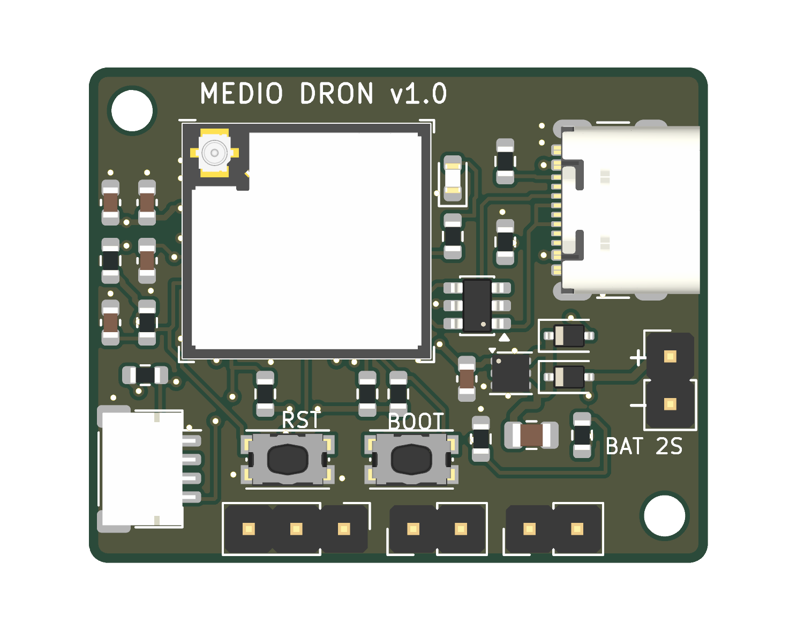
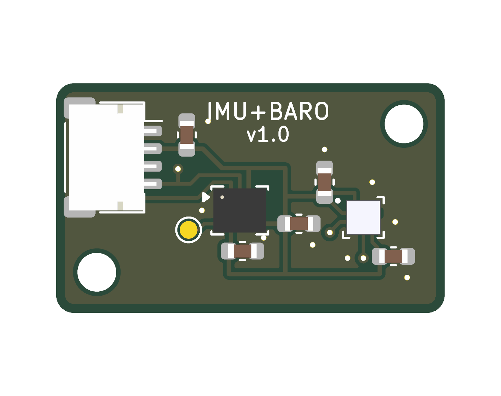

# Medio dron — hardware (KiCad 9)

Dos PCBs de 2 capas que comparten una librería propia. Abrir con **KiCad 9 o más nuevo**.

```
lib/                 símbolos, huellas y modelos 3D propios (medio_dron)
placa-principal/     ESP32-C3-MINI-1U, USB-C, LDO, ESC, Qwiic, ToF      33 × 26.4 mm
placa-sensores/      LSM6DSV16X + ICP-20100, Qwiic                      22 × 13 mm
```

En cada carpeta:
- `*.kicad_pro / .kicad_sch / .kicad_pcb` — proyecto, esquemático y placa.
- `*.pdf` — esquemático. `bom.csv` — lista de materiales.
- `img/` — renders 3D y plano de ensamble (referencias de cada componente).
- `fab/` — Gerbers + taladros (zip listo para JLCPCB) y archivo de posiciones.

| Placa principal | Placa de sensores |
|---|---|
|  |  |

## Estado
- [x] Esquemáticos v1.0 (ERC sin errores)
- [x] Layout v1.0 (DRC: 0 violaciones, 0 sin conectar, coincide con el esquemático)
- [ ] Revisión a mano antes de mandar a fabricar
- [ ] Pedido de PCBs + esténcil

## Reglas de diseño
Pista mínima 0.2 mm, separación 0.15 mm, vías 0.6/0.3 mm, 2 capas, plano de GND en ambas caras.
Pedir **esténcil** (capa F.Paste). Grosor recomendado: 1.0 mm (0.8 mm para la de sensores).

## Placa principal — pines del ESP32-C3
| GPIO | Uso |
|---|---|
| 0, 1 | SDA, SCL (Qwiic, pull-ups 2.2 k) |
| 2 | pull-up 10 k (pin de arranque) |
| 3 | VBAT por divisor 100 k / 27 k (ADC1_CH3) |
| 4 | ToF Pololu OUT |
| 5 | libre |
| 6, 7 | DShot ESC1, ESC2 |
| 8 | pull-up 10 k (pin de arranque) |
| 9 | botón BOOT |
| 10 | libre |
| 18, 19 | USB D−, D+ |
| 20 | LED (activo en alto) |
| 21 | libre (TX de arranque) |

Alimentación: batería 2S o USB → diodos Schottky → TLV76733 → 3.3 V.
Conectores de batería, ToF y ESC: huecos de 2.54 mm para soldar cables (rotulados por la cara de abajo).
El módulo es **MINI-1U**: necesita antena externa de 2.4 GHz con conector U.FL.

## Placa de sensores
- LSM6DSV16X en I²C **0x6A** (SA0 a GND). INT1 sale a un pad de prueba.
- ICP-20100 en I²C **0x63**. Su INT queda sin conectar.
- Sin pull-ups (están en la placa principal). Va en el brazo que se inclina.
- La huella del ICP-20100 se hizo con el patrón de la nota AN-000140 de TDK y el pin-out del datasheet DS-000416.
